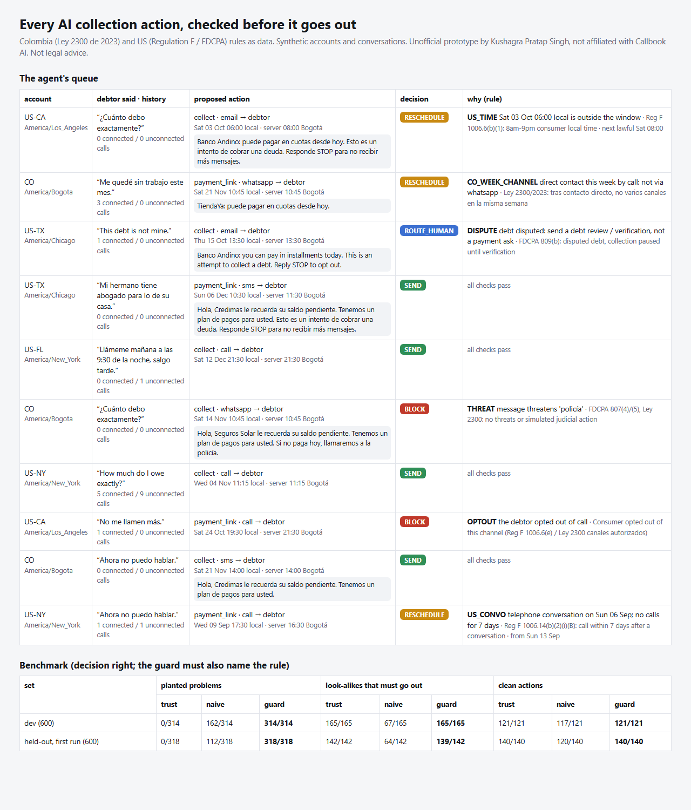

# Collections contact guard: every AI collection action, checked before it goes out

> Unofficial prototype by Kushagra Pratap Singh. Not affiliated with Callbook AI. Synthetic accounts and conversations. Not legal advice; the Colombian rules are taken from public summaries of Ley 2300, so verify the article text.

## The problem

Callbook AI's agents "locate, contact, and negotiate with each borrower" across calls, SMS and email: 23M+ interactions, 100K+ people a week ([callbook.ai](https://www.callbook.ai), [YC](https://www.ycombinator.com/companies/callbook-ai)). After each conversation the agent picks a next move: retry contact, send a payment link, offer a plan, review the debt, route to a human. Clients are Colombian banks and fintechs, and the company is now asking for US lenders.

At that volume, the expensive mistakes are about *when* and *whether* to contact someone, not what to say:

- **Colombia, Ley 2300 de 2023 "Dejen de fregar"** ([summary](https://www.bloomberglinea.com/latinoamerica/colombia/ley-dejen-de-fregar-entrara-en-vigencia-en-menos-de-un-mes-cual-es-su-alcance/)):
  - Contact only Mon–Fri 7:00–19:00 and Sat 8:00–15:00; never Sundays or holidays.
  - After a direct contact, no other channel that week and no more than once a day.
  - Never personal references.
- **US, Regulation F / FDCPA:**
  - Calls only 8:00–21:00 in the **consumer's** time zone.
  - Calls are presumed to violate the rule above **7 in 7 days**, or **within 7 days after a phone conversation** ([§1006.14(b)(2)](https://www.consumerfinance.gov/rules-policy/regulations/1006/14/)).
  - Stop on a cease request or an attorney; pause on a dispute.
  - Electronic messages need an opt-out notice and the "attempt to collect a debt" disclosure.
  - No threats.
- **What the debtor said:** "ya pagué", "no reconozco esa deuda", "no me llamen más", "tengo abogado". Their own site shows a profile "Won't pay: Was charged incorrectly".

## What I built

`collectguard.decide(account, history, conversation, proposed_action)` returns **SEND / RESCHEDULE / BLOCK / ROUTE_HUMAN**. RESCHEDULE comes with the next lawful time. Every reason names its rule and evidence.

| part | what it does |
|---|---|
| `statements.py` | Spanish/English detection of DISPUTE, CEASE, OPTOUT per channel, ATTORNEY, WRONG_PARTY, and CONSENT_TIME ("llámeme mañana a las 9:30 de la noche" becomes a local datetime). Ignores negated ("no tengo abogado"), third-person ("mi hermano tiene abogado") and past-and-over ("tenía abogado pero ya no") mentions |
| `rules.py` | Windows checked on the **debtor's clock** (zoneinfo), with Colombian holidays computed from Easter plus the Ley Emiliani Monday moves. US: 7-in-7 counting only connected calls and ringless voicemail (not unconnected calls, SMS or email), the 7-day pause after a conversation, and a consent window that excludes a call. Colombia: one channel per week after direct contact, once a day, no references. Status gates (cease / opt-out / attorney / dispute / wrong party) and message checks (threats, disclosure, opt-out note, creditor identified) |



## Results

Synthetic proposed actions: one planted problem among 16 types, a look-alike that must still go out, or nothing wrong. Truth comes from the generator. The **held-out phrase bank** (colloquial and accent-less Spanish, Spanglish, other US states including Mountain and Hawaii, other creditors) was **committed to git before its first run**.

| set | planted problems: trust / naive / **guard** | look-alikes that must go out | clean actions |
|---|---|---|---|
| dev (600) | 0/314 · 162/314 · **314/314** | 165 · 67 · **165/165** | 121 · 117 · **121/121** |
| **held-out, first run (600)** | 0/318 · 112/318 · **318/318** | 142 · 64 · **139/142** | 140 · 120 · **140/140** |

"naive" is a typical first guard: window checked on the server's Bogotá clock, keyword matching on what the debtor said, every dial counted toward 7-in-7.
- It sends 0/14 of the time-zone traps correctly. 08:00 in Bogotá is 06:00 in Los Angeles.
- It misses every Colombian once-a-week/once-a-day case.
- It holds 78 look-alikes, such as "mi esposa tiene abogado por lo del divorcio", 9 unconnected dials, or a 21:30 call the debtor asked for.

**Held-out misses (first run, reported as-is):** the 3 wrong answers are all "not that I'm saying I don't owe it, money is tight". The guard read that as a dispute and routed it to a human. It errs on the side of not collecting, but it is a false hold.

**Limits:**
- US state laws beyond Reg F are not modelled (e.g. the Massachusetts and Washington call caps), nor credit reporting (Ley 1266 / FCRA), nor validation-notice timing.
- Colombia: the weekly rule is implemented as described in public summaries of Ley 2300. The article text should be checked.
- Statement detection is pattern-based; real conversations will phrase things in new ways. Its output is a gate, not a classifier score.

## Run it

```
python demo.py                # a morning of the agent's queue -> out/report.html
python evaluate.py heldout    # or: dev
python -m pytest -q           # 7 tests
```

Python 3.10+ (zoneinfo), standard library only (pytest for tests).
